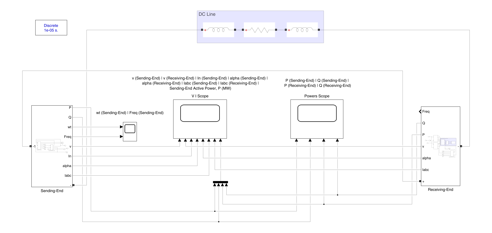
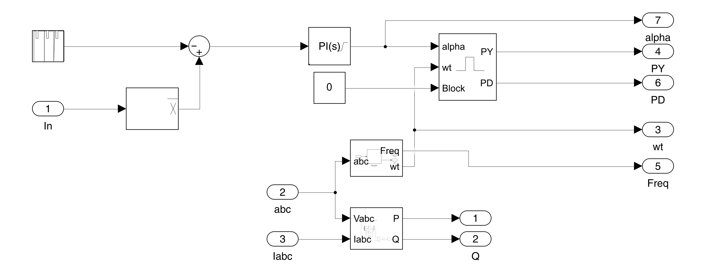
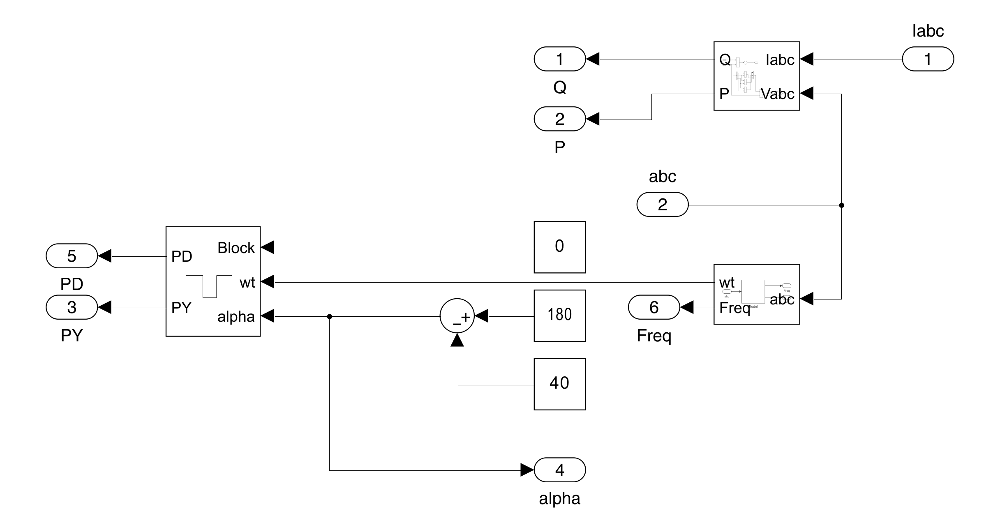
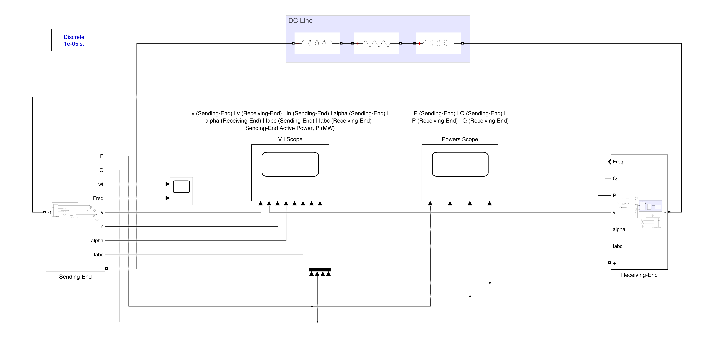
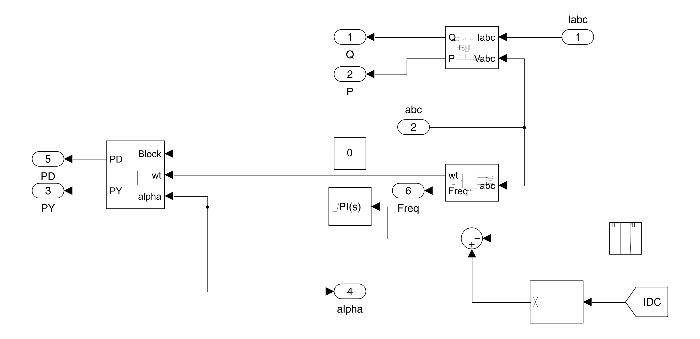
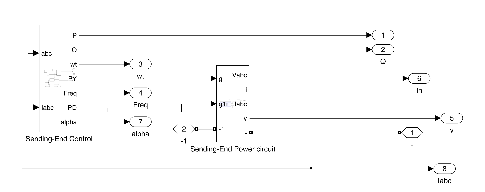
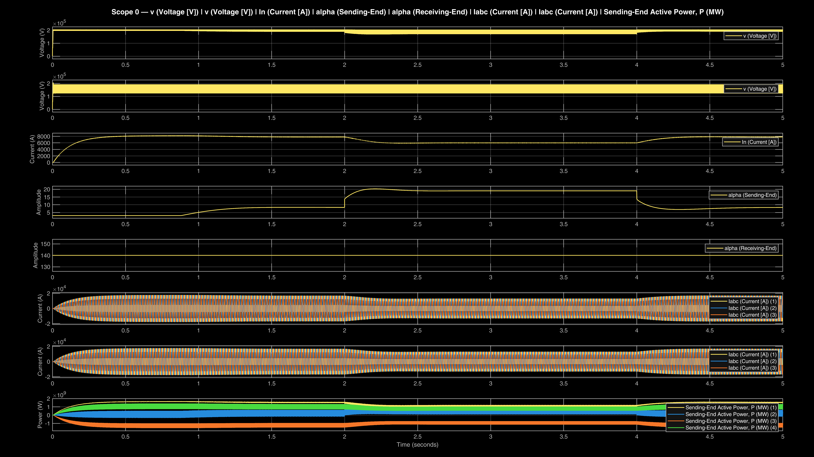
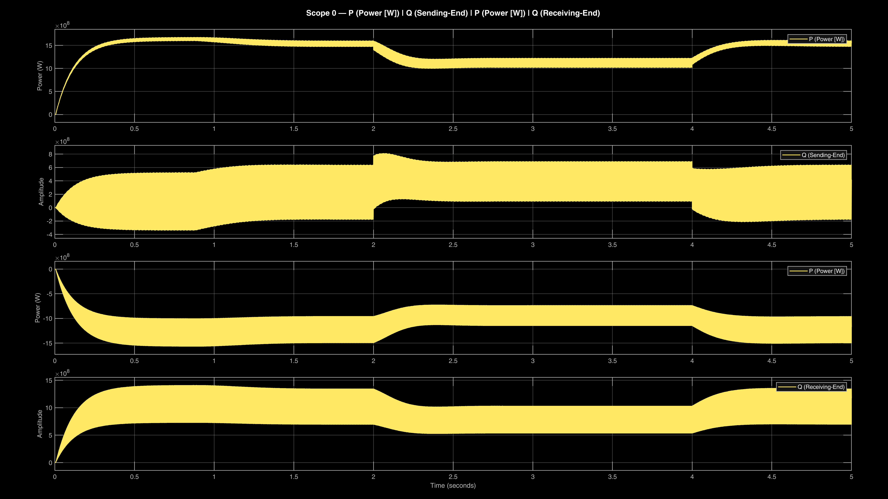
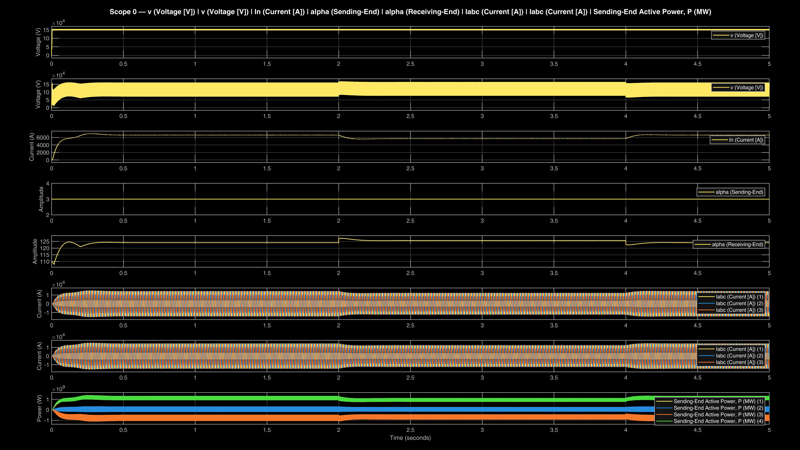
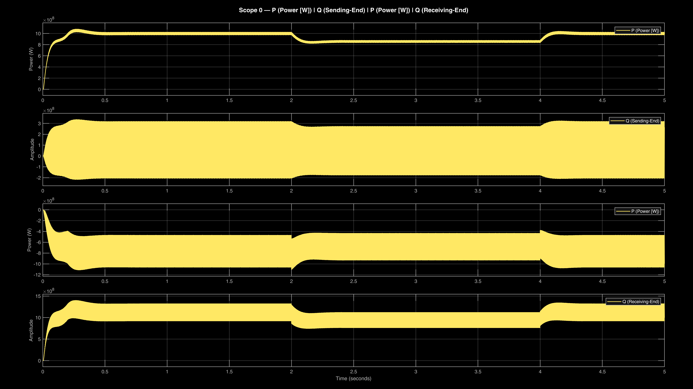

# ⚡ 12-Pulse LCC-HVDC Transmission System: Control & Fault Analysis


> **Project Engineer:** Abd El-Rhman Muhammad Saad  
> **Academic Institution:** Faculty of Engineering, Alexandria University (Class of 2026)  
> **Department:** Electrical Engineering Department  
> **Course / Specialization:** HVDC Transmission Systems  
> **Core Focus:** 1.56 GW 12-Pulse LCC-HVDC Link, Dual-Terminal CC/CEA Coordination & Dynamic Fault Ride-Through Handover

---

## 📌 Executive Summary & Architecture Overview

This repository documents the mathematical modeling, dual-terminal control design, dynamic simulation, and fault ride-through analysis of a high-power **$1.56\text{ GW}$, $+200.0\text{ kV}$ 12-Pulse Line-Commutated Converter (LCC) HVDC Transmission Link** implemented in MATLAB/Simulink (Simscape Electrical).

The transmission link connects two asynchronous AC grids operating at $50.0\text{ Hz}$ across a resistive DC transmission line ($R_{\text{dc}} = 5.0\ \Omega$):
* **Sending-End (Rectifier Station):** Connected to Bus A ($75.19\text{ kV}$ RMS line-to-line).
* **Receiving-End (Inverter Station):** Connected to Bus B ($77.618\text{ kV}$ RMS line-to-line).

To evaluate the operational robustness of the transmission corridor, the system is investigated under two distinct operational regimes:
1. **Case A (Normal Grid Operation):** Dual-terminal coordination utilizing **Constant Current (CC)** control at the rectifier and **Constant Extinction Angle (CEA)** control at the inverter ($\gamma = 40^\circ$), evaluated under large dynamic current step references ($7.8\text{ kA} \leftrightarrow 6.0\text{ kA}$).
2. **Case B (Severe 25% AC Voltage Sag & Control Handover):** Grid fault resilience under an abrupt $25\%$ voltage sag at Bus A, demonstrating an automated **control handover** where the rectifier clamps to **Constant Ignition Angle (CIA)** at $\alpha_{\text{min}} = 3^\circ$, while the inverter seamlessly assumes **Constant Current (CC)** control with a $5\%$ current margin.

---

## ⚙️ Master HVDC System Specifications

The physical and electrical design parameters are synthesized from industrial HVDC benchmark criteria and documented in Table 1 of the academic project report:

| Engineering Parameter | Symbol | Benchmark Value | Physical / Operational Significance |
| :--- | :---: | :---: | :--- |
| **Rated Transmission Capacity** | $P_{\text{rated}}$ | **$1.56\text{ GW}$** | Bulk high-voltage power transmission ceiling |
| **Nominal DC-Link Voltage** | $V_{\text{dc}}$ | **$+200.0\text{ kV}$** | Regulated pole-to-ground DC transmission potential |
| **Rated DC Line Current** | $I_{\text{dc}}$ | **$7.8\text{ kA}$** | Nominal current setpoint ($1.56\text{ GW} / 200.0\text{ kV}$) |
| **DC Transmission Line Resistance** | $R_{\text{dc}}$ | **$5.0\ \Omega$** | Lumped loop resistance over long-distance line |
| **Sending-End (Bus A) AC Potential** | $V_{\text{ac,A}}$ | **$75.19\text{ kV}$ (RMS)** | Rectifier station three-phase interface potential |
| **Receiving-End (Bus B) AC Potential** | $V_{\text{ac,B}}$ | **$77.618\text{ kV}$ (RMS)**| Inverter station three-phase interface potential |
| **AC System Frequency** | $f_{\text{grid}}$ | **$50.0\text{ Hz}$** | Synchronous grid operating frequency |
| **Nominal Commutation Overlap** | $\mu$ | **$0^\circ$** | Ideal zero overlap assumption for baseline design |
| **Target Inverter Extinction Angle** | $\gamma_{\text{ref}}$ | **$40.0^\circ$** | Commutation margin preventing inverter failure |
| **Rectifier Minimum Firing Angle** | $\alpha_{\text{min}}$ | **$3.0^\circ$** | Forward thyristor recovery voltage threshold |
| **Current Controller Margin** | $I_{\text{margin}}$ | **$5.0\%$** | Offset margin preventing control fight ($0.39\text{ kA}$) |
| **Converter Transformer Configuration**| — | **$Y-Y$ and $Y-\Delta$** | $30^\circ$ displacement canceling 5th & 7th harmonics |

---

## 🧠 Control Physics & Mathematical Formulations

```text
               SENDING-END (RECTIFIER)                         RECEIVING-END (INVERTER)
         ┌─────────────────────────────────┐             ┌─────────────────────────────────┐
         │ Case A: Constant Current (CC)   │             │ Case A: Constant Extinction     │
         │         Adjusts α to track I_ref│             │         Angle (CEA: γ = 40°)    │
         │ Case B: Constant Ignition       │             │ Case B: Inverter Current        │
         │         Angle (CIA: α_min = 3°) │             │         Control (CC Margin: 5%) │
         └────────────────┬────────────────┘             └────────────────┬────────────────┘
                          │                                               │
                          ▼                                               ▼
         ┌─────────────────────────────────┐   +200 kV DC Line    ┌─────────────────────────────────┐
         │ 12-Pulse Thyristor Bridge       ├─────────────────────►│ 12-Pulse Thyristor Bridge       │
         │ (Y-Y & Y-Δ Transformers)        │      (R_dc = 5 Ω)    │ (Y-Y & Y-Δ Transformers)        │
         └─────────────────────────────────┘                      └─────────────────────────────────┘
```

### 1. 12-Pulse Converter DC Voltage Derivation

The 12-pulse converter topology cascades two three-phase six-pulse Graetz thyristor bridges fed by isolated secondary transformer windings displaced by $30^\circ$ electrical (one $Y-Y$ bank and one $Y-\Delta$ bank).

Assuming ideal zero overlap angle ($\mu = 0^\circ$), the average DC voltage generated across each 6-pulse bridge as a function of the firing angle $\alpha$ is:

$$V_{d0,6} = \frac{3\sqrt{2}}{\pi} V_{\text{LL}} \approx 1.35 \cdot V_{\text{LL}}$$

Because both six-pulse bridges are connected in series on the DC side, the total open-circuit average DC voltage synthesized by the 12-pulse station is:

$$V_{\text{dc}}(\alpha) = 2 \cdot V_{d0,6} \cos\alpha = \frac{6\sqrt{2}}{\pi} V_{\text{LL}} \cos\alpha$$

### 2. DC Transmission Line Steady-State Voltage Balance

Power transfer through the DC link is governed by the potential difference between the rectifier output voltage ($V_{\text{rect}}$) and the inverter terminal voltage ($V_{\text{inv}}$):

$$I_{\text{dc}} = \frac{V_{\text{rect}} - V_{\text{inv}}}{R_{\text{dc}}}$$

At full nominal capacity ($P = 1.56\text{ GW}, V_{\text{rect}} = 200.0\text{ kV}, I_{\text{dc}} = 7.8\text{ kA}$):

$$\Delta V_{\text{dc}} = I_{\text{dc}} \cdot R_{\text{dc}} = 7.8\text{ kA} \times 5.0\ \Omega = \mathbf{39.0\text{ kV}}$$

$$V_{\text{inv}} = V_{\text{rect}} - \Delta V_{\text{dc}} = 200.0\text{ kV} - 39.0\text{ kV} = \mathbf{161.0\text{ kV}}$$

For the inverter operating under extinction angle $\gamma$:
$$V_{\text{inv}} = \frac{6\sqrt{2}}{\pi} V_{\text{LL,B}} \cos\gamma = 200.0\text{ kV} - 39.0\text{ kV} = 161.0\text{ kV}$$

Setting $\gamma = 40.0^\circ$ determines the required transformer secondary turn ratios and voltage ratings for Bus B.

---

## ⚖️ Dual-Terminal Control Coordination: Case A vs. Case B

The dual-terminal control philosophy coordinates converter firing angles to prevent current margin collisions and maintain continuous power transfer:

| Operational Dimension | Case A: Normal Grid Operation | Case B: Severe 25% AC Voltage Sag |
| :--- | :--- | :--- |
| **Grid Health Status** | Balanced, nominal AC voltages at both buses | **$25\%$ symmetrical voltage sag** at Rectifier Bus A |
| **Rectifier Station Mode** | **Constant Current (CC)** control | **Constant Ignition Angle (CIA)** at $\alpha_{\text{min}} = 3.0^\circ$ |
| **Rectifier Action** | Continuously modulates $\alpha$ ($15^\circ - 35^\circ$) to track $I_{\text{ref}}$ | Voltage drops below link threshold; hits hard lower limit $\alpha = 3^\circ$ |
| **Inverter Station Mode** | **Constant Extinction Angle (CEA)** at $\gamma = 40^\circ$ | **Inverter Constant Current (CC)** control |
| **Inverter Action** | Regulates counter-voltage to maintain extinction margin | Detects current drop; takes over link current regulation |
| **Active Current Setpoint** | $7.8\text{ kA} \leftrightarrow 6.0\text{ kA}$ step commands | $I_{\text{ref,inv}} = I_{\text{ref}} - I_{\text{margin}} = 7.0\text{ kA} - 0.35\text{ kA} = 6.65\text{ kA}$ |
| **Harmonic Performance** | 5th and 7th AC current harmonics cancelled ($30^\circ$ shift) | Harmonics suppressed; link operation preserved without trip |
| **Fault Ride-Through State** | Steady tracking without control mode switching | **Bumpless automated control handover** executed safely |

---

## 📐 Architecture Schematics & Control Circuitry

### 1. Case A: Master System Architecture (Normal Grid Operation)
Top-level Simulink implementation of the $1.56\text{ GW}$ link connecting the sending and receiving stations:

<p align="center">
  
</p>

### 2. Case A: Sending-End Constant Current (CC) Control Circuit
The PI current controller compares measured DC current with the step reference, synthesizing the firing pulse delay angle $\alpha$:

<p align="center">
  
</p>

### 3. Case A: Receiving-End Constant Extinction Angle (CEA) Control Circuit
Maintains extinction angle $\gamma = 40.0^\circ$ to guarantee thyristor turn-off deionization time and prevent commutation failure:

<p align="center">
  
</p>

---

### 4. Case B: Master System Architecture (25% Voltage Sag Condition)
Incorporates the AC voltage sag block at Bus A and the automated control handover logic:

<p align="center">
  
</p>

### 5. Case B: Inverter Automated Control Handover Logic
Demonstrates the current margin subtraction and mode selector transitioning the inverter into active current regulation:

<p align="center">
  
</p>

### 6. Case B: Rectifier Constant Ignition Angle (CIA) Limiting
Illustrates the lower-bound limiter locking the firing angle to $\alpha_{\text{min}} = 3.0^\circ$ during depressed AC voltage:

<p align="center">
  
</p>

---

## 📊 Comprehensive Simulation Results & Waveform Verification

### 1. Case A: Dynamic Tracking under Current Steps ($7.8\text{ kA} \leftrightarrow 6.0\text{ kA}$)

#### Multi-Channel VI Telemetry (Voltage, Current & Firing Angles)
Shows instantaneous current reference tracking, rectifier DC voltage ($200.0\text{ kV}$), and balanced three-phase AC currents:

<p align="center">
  
</p>

#### Active (P) and Reactive (Q) Power Profiles
Active power steps cleanly between $1.56\text{ GW}$ and $1.20\text{ GW}$, while reactive power consumption tracks converter firing angles:

<p align="center">
  
</p>

---

### 2. Case B: Fault Ride-Through under 25% Rectifier AC Voltage Sag

#### Multi-Channel VI Telemetry during Automated Handover
Under the $25\%$ sag, the rectifier firing angle clamps to $\alpha_{\text{min}} = 3.0^\circ$. The inverter immediately takes over current regulation, sustaining DC current at $I_{\text{ref}} - I_{\text{margin}}$ with zero interruption:

<p align="center">
  
</p>

#### Active and Reactive Power Dynamics during Grid Fault
Confirms continuous power flow during the depressed grid state, preventing total transmission corridor blackout:

<p align="center">
  
</p>

---

## 📂 Repository Structure & Simulation Guide

```text
hvdc-12pulse-lcc-simulation/
├── README.md                                          # Master engineering documentation & mathematical report
├── Simulation/
│   ├── HVDC_Case_A.slx                               # Simulink model: Normal operation (Rectifier CC / Inverter CEA)
│   └── HVDC_Case_B.slx                               # Simulink model: 25% AC sag with automated control handover
├── Docs/
│   ├── 12-Pulse LCC-HVDC Transmission System.pdf     # Full academic engineering report (April 2026)
│   └── LaTeX_Source/                                 # LaTeX source files, vector schematics, and report assets
└── images/                                            # 300 DPI curated engineering schematics & scope captures
    ├── Case_A_Power_Scope.png
    ├── Case_A_Receiving_Control_CEA.png
    ├── Case_A_Sending_Control_CC.png
    ├── Case_A_System_Architecture.png
    ├── Case_A_VI_Scope.png
    ├── Case_B_Power_Scope.png
    ├── Case_B_Receiving_Control_Handover.png
    ├── Case_B_Sending_Control_CIA.png
    ├── Case_B_System_Architecture.png
    └── Case_B_VI_Scope.png
```

### Steps to Run the Models in MATLAB/Simulink

1. **Toolchain Prerequisites:**
   * MATLAB / Simulink **R2024b** (or R2022b+ compatible).
   * **Simscape Electrical** (Specialized Power Systems toolbox).
2. **Execution Steps (Case A - Normal Operation):**
   * Open `Simulation/HVDC_Case_A.slx`.
   * Click **Run** (`Ctrl+T`) for a $5.0\text{ s}$ simulation.
   * Open `Scope_0_v_In_alpha_Iabc_SendingEndActivePowerP` to observe the step responses at $t = 2.0\text{ s}$ and $t = 4.0\text{ s}$.
3. **Execution Steps (Case B - Voltage Sag & Handover):**
   * Open `Simulation/HVDC_Case_B.slx`.
   * Click **Run** (`Ctrl+T`).
   * Observe how the inverter takes over current regulation when the rectifier voltage drops below transmission margin.

---

## 👤 Author & Academic Metadata

**Abd El-Rhman Muhammad Saad**  
*Electrical Engineering Department, Faculty of Engineering, Alexandria University*  
*Specialization: Power Systems, High-Voltage Direct Current (HVDC) & Power Electronics*  

[](https://linkedin.com/in/Abd-El-Rhman-Saad)
[](https://github.com/Abd-El-Rhman-Saad)
[](mailto:abdelrhmanmsaad22@gmail.com)
