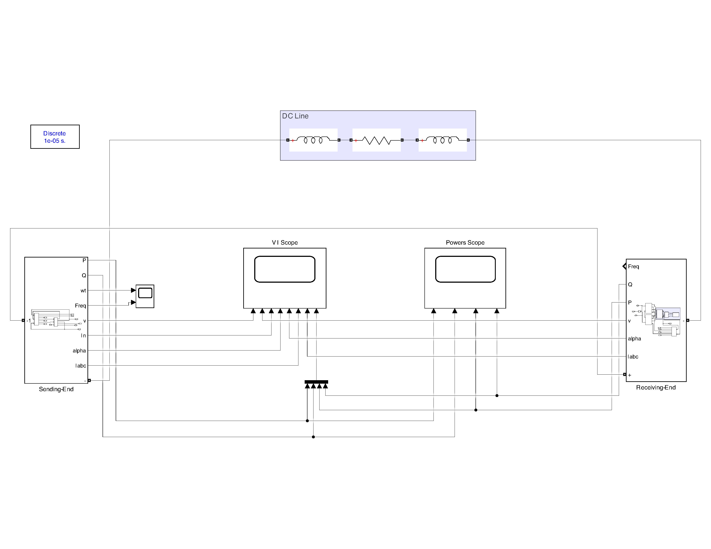
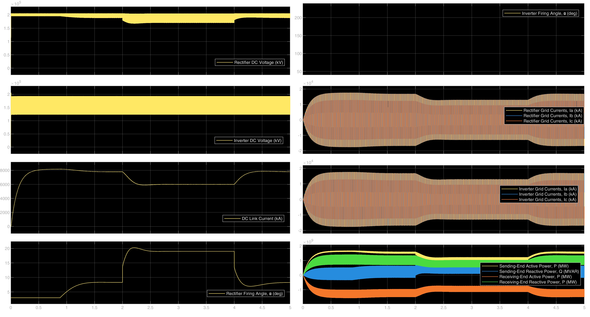
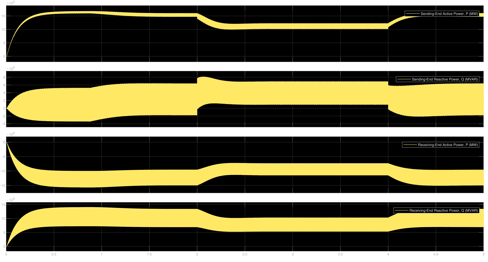
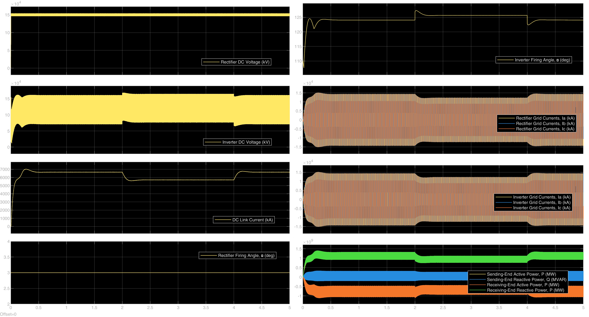
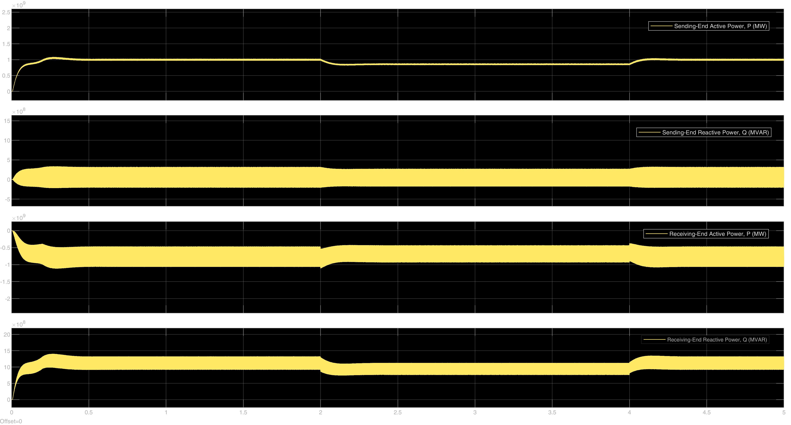

# 12-Pulse LCC-HVDC Transmission System: Control & Fault Analysis

## 🚀 Overview
MATLAB/Simulink model of a **12-pulse Line-Commutated Converter (LCC) HVDC** link. The study checks steady-state accuracy, reference tracking and behavior under a severe AC voltage sag, using a dual-terminal control scheme with an **automatic control handover** during the fault.

## 🎯 Problem Statement
A **1.56 GW, +200 kV** DC link transfers power from Bus A (50 Hz, 75.19 kV RMS) to Bus B (50 Hz, 77.618 kV RMS) over a DC line of **5 Ω**. Zero overlap angle is assumed.

### Case A — Normal operation
* **Target:** rectifier DC voltage 200 kV and inverter extinction angle γ = 40°.
* **Control:** Constant Current (CC) at the rectifier, Constant Extinction Angle (CEA) at the inverter.
* **Dynamic test:** reference current steps **7.8 kA → 6 kA** at t = 2 s and back to 7.8 kA at t = 4 s.

### Case B — 25% voltage sag at the rectifier
* The rectifier switches to **Constant Ignition Angle (CIA)** at αmin = 3°.
* The inverter takes over **CC control** with a current margin of 5% of the rectifier reference current.
* **Dynamic test:** reference current steps **7 kA → 6 kA** at t = 2 s and back to 7 kA at t = 4 s.

## 🛠️ Technical Stack
* MATLAB / Simulink (Simscape Electrical)
* 12-pulse thyristor converters (Y-Y and Y-Δ transformers)
* Control modes: CC, CEA, CIA
* Topics: PI tuning, fault ride-through, dual-terminal coordination

## ⚙️ Results

### Case A: normal operation
The system tracks the current steps (7.8 kA ↔ 6 kA). The 12-pulse arrangement cancels the 5th and 7th AC-side harmonics.

| Voltage & Current | Active & Reactive Power |
| :---: | :---: |
|  |  |

### Case B: 25% voltage sag
The sag forces the rectifier into CIA mode; the inverter leaves CEA mode and regulates the current (CC) with the 5% margin, so the link keeps operating.

| Handover Dynamics | Power Flow During the Fault |
| :---: | :---: |
|  |  |

## 📂 Repository Structure
* `Simulation/HVDC_Case_A.slx` — normal operation.
* `Simulation/HVDC_Case_B.slx` — 25% sag with control handover.
* `Docs/12-Pulse LCC-HVDC Transmission System.pdf` — report with modeling, specifications and waveform analysis.
* `Docs/LaTeX_Source/` — LaTeX source and figures.

## ▶️ How to Run
Open `HVDC_Case_A.slx` or `HVDC_Case_B.slx` in MATLAB/Simulink (Simscape Electrical required) and press **Run**.

## 👨‍💻 Author
**Abd El-Rhman Muhammad Saad** — Electrical Power and Machines Engineering, Alexandria University.
[LinkedIn](https://linkedin.com/in/Abd-El-Rhman-Saad) · [GitHub](https://github.com/Abd-El-Rhman-Saad)

*Completed as part of the HVDC Transmission Systems coursework.*
